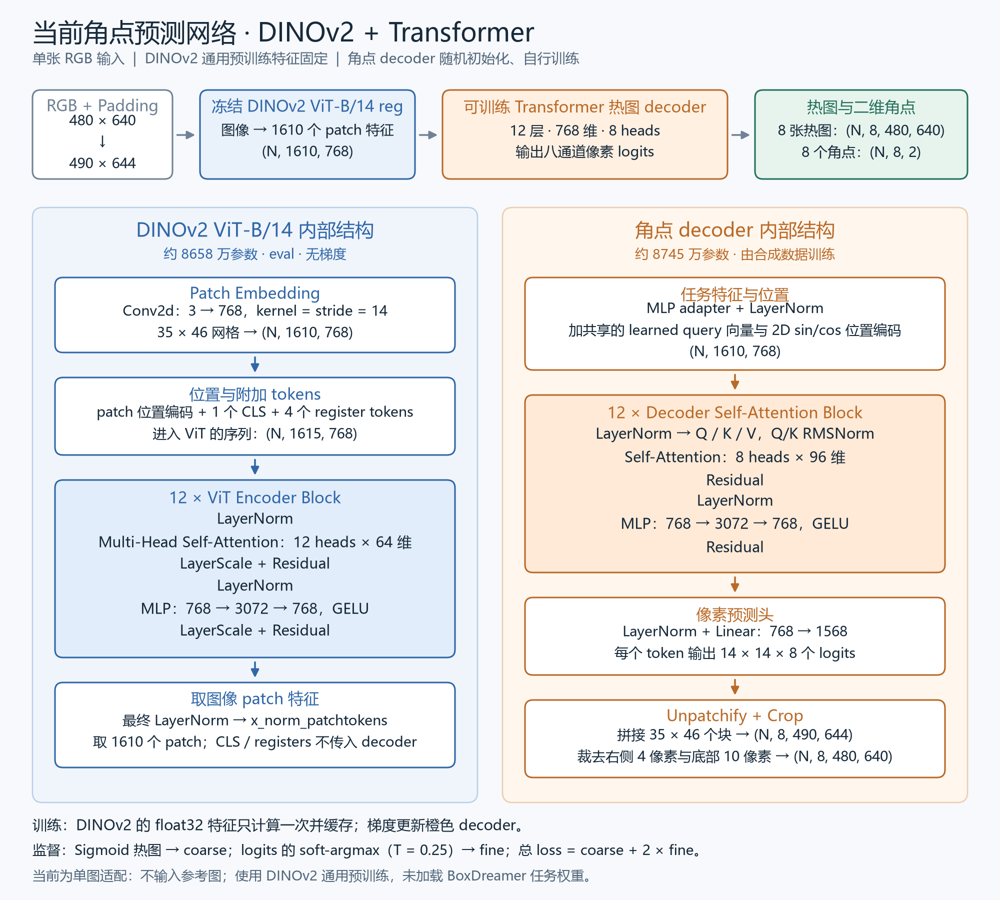

# 单图 DINOv2 + Transformer 角点网络
采用 DINOv2 的通用视觉预训练特征，角点 decoder 从随机初始化开始训练。输入仍是一张 RGB，训练数据和 `coarse + 2×fine` 沿用当前版本。
## 网络


[SVG 矢量版](figures/dino_transformer_architecture.svg)。生成脚本为 `tools/draw_architecture.py`。
```text
RGB                              (N, 3, 480, 640)
Pad right/bottom                 (N, 3, 490, 644)
Frozen DINOv2 ViT-B/14 reg        (N, 1610, 768)
MLP + LayerNorm
Learned query + 2D sin/cos positions
12 × self-attention block        (N, 1610, 768)
LayerNorm + Linear               (N, 1610, 14×14×8)
Unpatchify                       (N, 8, 490, 644)
Crop padding                     (N, 8, 480, 640)
Sigmoid / logit soft-argmax       heatmaps / (N, 8, 2)
```
DINOv2 使用 `dinov2_vitb14_reg`，包含 4 个 register tokens；只取 `x_norm_patchtokens`，共 35×46 个图像 patch。输入已经经过 Dataset 的 ImageNet normalization，不重复归一化，也不做额外 resize 或中心裁剪。
DINOv2 自身也是 Transformer：ViT-B/14 将每个 14×14×3 的 patch 投影为 768 维，加入 1 个 CLS、4 个 register tokens 和位置编码，内部序列长 1615。经过 12 个 ViT block，每层 12 heads、每个 head 64 维，MLP 为 768→3072→768，并使用 LayerNorm、LayerScale 与残差连接。最终 LayerNorm 后只取 1610 个图像 patch 特征。
decoder 为 12 层、768 维、8 heads，MLP ratio=4。每层包括 pre-LayerNorm、带 Q/K RMSNorm 的全局 self-attention、残差和 MLP。学习到的 query embedding 与所有图像 patch 特征相加；单图任务不接入参考图和参考角点热图。
Linear 为每个 token 输出一个 14×14×8 的像素块，按行列顺序 unpatchify 成完整热图。补齐区在 Sigmoid 和坐标提取前裁掉，因此标签仍使用原始 640×480 坐标。
该设计参考 [BoxDreamer §3.2–3.4](https://arxiv.org/html/2504.07955v2#S3.SS2) 和其 [BETR decoder](https://github.com/zju3dv/BoxDreamer/blob/106f3c16c746770cbad80720ce4a557eb31f30f5/src/models/modules/backbone/betr.py)。本版保留单图输入、`[0,1]` 热图与 T=0.25 的可微坐标解码；为稳定完整 fine 监督，在预测头前增加 LayerNorm，预测头权重采用 std=0.001 的小幅初始化。
## 权重与训练范围
DINOv2 有 86,583,552 个参数，固定为 eval 并关闭梯度。角点 decoder 约 8745 万个参数，通过当前合成数据训练。未加载 BoxDreamer 的任务 checkpoint。
训练阶段缓存冻结 encoder 的 float32 特征。1000 张训练图和 200 张验证图共约 5.94 GB，均位于 S 盘；缓存解码与在线图像编码使用相同的预处理和数值精度，坐标对照差异为 0 px。decoder 使用 BF16 训练，验证和 soft-argmax 坐标保持 float32。
原 ResNet 网络、权重和 47.78 px 验证结果保留作为对照。两版同时改变了 backbone、decoder 和初始化来源，因此它们的结果比较反映完整方案差异。
## 运行
在项目根目录、已有 PyTorch 环境中执行：
```powershell
python -m predict_corner.tools.prepare_dinov2
python -m unittest discover -s predict_corner/tests -v
python -m predict_corner.tools.check_dino_model --batch-size 8
python -m predict_corner.tools.cache_dino_features
python -m predict_corner.tools.fit_dino --steps 1000 --learning-rate 0.0001 --output results/new_dino_single_image
python -m predict_corner.tools.train_dino --epochs 20 --batch-size 8 --learning-rate 0.0001 --patience 5 --output results/new_dino_training
python -m predict_corner.tools.test_video --architecture dino --weights results/new_dino_training/best.pt --output results/new_dino_video
```
数据缓存和实验输出使用新目录；`cache_dino_features` 默认缓存目录已存在时无需重跑。预训练源码、权重和清单位于 `.cache/torch/`，不占用 C 盘模型缓存。
核心代码为 `dino_model.py`、`heatmap_decoder.py`，特征 Dataset 为 `feature_dataset.py`。下载、缓存、检查、拟合和训练脚本位于 `tools/`。图片预测和原 20 张数据评估也支持 `--architecture dino`，使用新训练的完整 checkpoint。
## 每个 decoder block 的参数
以当前 768 维、8 heads 为例，权重尺寸采用 PyTorch 的 `(out_features,in_features)`：
| 部分 | 参数 |
|---|---|
| Q/K/V 投影 | weight `(2304,768)`，bias `(2304,)`，得到三个 768 维张量 |
| Attention 输出投影 | weight `(768,768)`，bias `(768,)` |
| MLP 第一层 | weight `(3072,768)`，bias `(3072,)` |
| MLP 第二层 | weight `(768,3072)`，bias `(768,)` |
| 两个 LayerNorm | 各一组 768 维缩放和 768 维偏移 |
| Q/K RMSNorm | Q、K 各一个 96 维缩放向量 |
每层共 7,088,064 个参数，12 层合计 85,056,768。各层参数独立。Q/K/V 随输入计算，可学习的是生成它们的投影矩阵；位置编码为固定的 sin/cos 值，query embedding 位于 block 之外。
## 首轮训练结果
2026-10-25，完成 20 epochs，最佳权重来自第 20 轮。配置为 batch size=8、AdamW lr=1e-4、weight decay=0.01、cosine 至 1e-6、seed=42，冻结 DINOv2，仅训练随机初始化的 decoder。包含最终评估共约 20.6 分钟，decoder 训练峰值显存约 7.62 GiB。
| 指标 | 原 ResNet-18 | DINOv2 + Transformer |
|---|---:|---:|
| 训练集平均角点误差，eval | 8.55 px | 26.57 px |
| 验证集平均角点误差 | 47.78 px | 38.98 px |
| 验证集角点误差 ≤10 px | 13.56% | 7.63% |
| 验证集角点误差 P95 | 144.28 px | 99.59 px |
| 单图平均误差 >100 px 的验证图数 | 17/200 | 5/200 |
| 原来 4 张留出图的平均角点误差 | 31.92 px | 29.82 px |
这轮主要减少了较大的错误，平均误差下降，但 10 px 内的精准定位比例也下降，仍存在精度分布不均匀的问题。它是首轮 20 epochs 的结果；后段仍在改善，目前没有据此认定已充分收敛。
本轮输入原始 RGB 与读取 float32 缓存特征，在全部 200 张验证图上的坐标差异为 0 px。DINOv2 训练前后状态哈希一致，冻结检查通过。
完整视频位于 `results/dino_transformer_video/full_video_overlay.mp4`，裁剪视频为 `camera_crops.mp4`；同步对比为 `resnet_vs_dino.mp4`，左侧为原 ResNet，右侧为本轮 DINOv2 + Transformer。两侧使用同一套修正 ROI。视频没有角点真值，部分画面仍有框体变形与错位。
## 保存与继续训练
本轮目录为 `results/dino_transformer_training/`：
- `best.pt`：最佳验证权重，包含 DINOv2 和 decoder，用于推理。
- `last.pt`：最后一轮完整模型，与训练状态配套。
- `training_state.pt`：decoder、AdamW 动量、scheduler、epoch、CPU/CUDA 与 DataLoader 随机状态。
- `config.json`、`history.csv`、`training_curves.png`：配置和逐轮记录。
- `source_snapshot/`：与本轮配置哈希一致的实际训练源码。训练期间按要求新增的续训入口保存在当前 `tools/train_dino.py`。
最佳模型另存为 `predict_corner/checkpoints/corner_predictor_dino.pt`，配套 JSON 记录模型配置和哈希。预测和评估工具指定 `--architecture dino` 时默认读取这份权重，也可用 `--weights` 指定其他文件。
追加训练示例：
```powershell
python -m predict_corner.tools.train_dino --resume results/dino_transformer_training --epochs 20 --learning-rate 0.00003 --output results/new_dino_continuation
```
这里的 `--epochs 20` 表示追加 20 轮。载入最后一轮的模型、AdamW 动量和随机状态，以显式指定的学习率开始新的 cosine 阶段；原 scheduler 状态也保存在训练文件中。输出使用新目录，原来的最佳权重保留。
续训检查已实际载入最后一轮参数和 optimizer，并在内存中完成一次更新：AdamW step 从 2500 接到 2501，decoder 更新、DINOv2 保持不变，原 checkpoint 文件未改动。具体结果见 `resume_check.json`。
## 实现检查
- 当前 27 项测试通过，包括缓存特征验证时的热图尺寸检查。
- 非方形图像的 patch 排列、通道顺序、padding 裁除、二维位置编码通过测试。
- 冻结 encoder 保持 eval 且无梯度；fine 单独对 attention 和预测头产生非零梯度。
- BF16 attention 输出和梯度为有限值。
- 初次单图拟合用 lr=3e-4，最佳平均误差约 37.61 px；改为 1e-4 后约 7.81 px，仍有角点停在错误峰值。
- 增加输出 LayerNorm 与小幅预测头初始化后，第 550 步平均误差约 0.99 px，最大约 1.58 px。完整日志保留在各单图实验目录中。
- 独立复核在第 550 步得到平均 0.96 px、最大 1.62 px，满足平均小于 1 px、最大小于 2 px；满足条件的 decoder 保存为 `results/dino_transformer_single_image_verified/passed_decoder.pt`，主实验仍从随机 decoder 开始。
